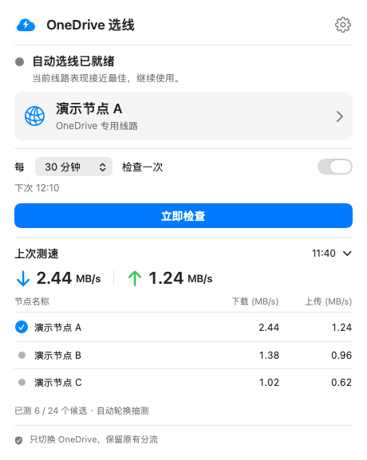

# OneDrive Node Pilot · OneDrive 选线

**定时比较 VPN／代理节点，为 OneDrive 自动选择更优线路，帮助提升上传与下载同步速度。**

OneDrive Node Pilot 是一款 macOS 菜单栏工具，配合 Clash Verge 使用：按设定间隔比较节点的上传、下载与连接表现，为 OneDrive 专用策略组选择双向表现更好的节点，减少手动试线。其他软件继续遵循 Clash 原有分流。



*软件界面使用虚构节点和演示测速数据，不包含真实订阅、节点或账号信息。测速用于选线参考，不代表实际同步速度或提升保证。*

只切换 OneDrive 专用组；保留 Clash 原有模式、其他分流、DNS、系统代理与路由。配置不满足隔离条件时停止切换。MIT 开源，不包含节点、订阅、个人配置或预编译的第三方代理内核。

## 环境要求

- Apple Silicon Mac、macOS 13 或以上。
- Xcode Command Line Tools（提供 Swift 编译器）；当前源码使用 Swift 5 语言模式。
- 安装于 `/Applications/OneDrive.app` 的 OneDrive。
- 安装于 `/Applications/Clash Verge.app` 的 Clash Verge Rev，内核支持 Unix socket 控制接口和进程规则。
- 系统自带的 curl 和 Ruby。不同 Clash/OneDrive 版本可能需要适配路径。

## 构建与运行

```sh
git clone https://github.com/q204194164-arch/onedrive-node-pilot.git
cd onedrive-node-pilot
zsh build.sh
zsh scripts/test.sh
open 'build/OneDrive 选线.app'
```

构建产物是本地 ad-hoc 签名的 App，未公证。长期使用及启动联动前，将它放入 `/Applications`；移动 App 后如启用了启动联动，请关闭再重新开启。项目不附带或下载 mihomo 内核，而是使用用户已安装的 Clash Verge 内核。

公开版使用通用 bundle ID，与早期个人构建不同，因此可能需要重新设置偏好。

## 先配置专用分流

App **不自动写入、重载或修复** Clash 配置。请在 Clash 的本地增强配置中创建一个名称完全匹配的手动选择组：

```yaml
proxy-groups:
  - name: OneDrive 独立线路
    type: select
    proxies:
      - YOUR_EXISTING_NODE_NAME
```

用你现有的节点名替换占位符，可列出多个节点。不要上传真实节点配置。这是需要合并到既有配置中的片段，不是完整配置。

在原规则前仅增加以下两条（有效规则列表的前两条必须一致）：

```yaml
rules:
  - PROCESS-PATH,/Applications/OneDrive.app/Contents/MacOS/OneDrive,OneDrive 独立线路
  - PROCESS-PATH,/Applications/OneDrive.app/Contents/PlugIns/OneDrive File Provider.appex/Contents/MacOS/OneDrive File Provider,OneDrive 独立线路
  # 此后完整保留你原有规则，包括原来的最终规则。
```

Clash UI 使用规则模式；App 不改变模式。确保内核能识别进程路径。其他规则及策略组不能引用该专用组（内核生成的 GLOBAL 列表除外）。不要添加面向所有软件的 OneDrive 域名规则或替换原来的兜底规则。

该规则覆盖这两个进程的所有目标地址；如果未来 OneDrive 增加其他网络进程，需要检查和适配，不能保证未经检查的新进程也被覆盖。

## 使用

- 左键点击菜单栏云朵闪电图标打开面板；右键或 Control 点击打开快捷菜单。
- 每 **15 / 30 / 60 / 120 分钟**检查一次，默认 30 分钟；支持立即检查和停止本轮。
- 面板展示当前节点、下次检查、可展开的上次测速与候选结果。
- 齿轮设置支持登录后启动、跟随 OneDrive 启动（默认关闭）、测速说明。
- 启动联动使用本 App 的轻量 LaunchAgent 监听 OneDrive 启动事件。关闭选项会停止组件并删除对应 plist；它不会修改 OneDrive 的登录设置。退出选线 App 后直到下次 OneDrive 启动才会再次联动打开。

## 测速与切换边界

独立的 mihomo 子进程绑定物理网卡，不启用 TUN。先测 OneDrive API 连接延迟，再每轮实测最多 6 个候选：低延迟节点、当前节点和轮换候选。每个候选下载微软公开安装包的 2 MiB，并向 Cloudflare 测速端点上传 1 MiB 随机数据。

上传/下载调和平均分提高超过 20%，且候选复测通过后才切换。每轮传输预算约 21 MiB，另有协议及连接检查流量。下载衡量微软 CDN 链路，上传衡量 Cloudflare 链路；**这不等于 OneDrive 实际同步速度，也不保证找到所有任务的绝对最快节点**。

测速前后核对原有规则、主代理设置和其他手动选择器。发现设置变化、用户取消、API 不可用或检测到其他软件较大流量时放弃本轮切换。其他流量检测仅覆盖 Clash 可见的连接，并受采样间隔影响；测速仍会占用共享网络带宽，不能承诺绝对零影响。

App 对主 Clash 的唯一写操作是切换 `OneDrive 独立线路`。它不会关闭已有连接，现有传输可继续使用旧连接。

## 隐私

详见 [PRIVACY.md](PRIVACY.md)。不读取 OneDrive 文件、不接收账号密码、不向本项目作者发送遥测。测速服务、节点服务和 DNS 服务可看到相应请求的网络元数据。

仓库只包含源码、通用测试和文档，不包含真实节点名称、服务器地址、订阅链接、控制密钥、用户路径、运行报告或本机构建产物。展示截图仅使用演示数据。

## 开发验证

```sh
zsh scripts/test.sh
python3 scripts/check-public-files.py
```

`Tests/ProbeCLI.swift` 是可选真实网络检查入口：读取本机 Clash 配置并仅测速，不切换。`Tests/IsolationCLI.swift` 会临时切换专用组并尝试恢复，仅应在了解其作用时手动运行。二者可能输出本机节点信息，请勿直接公开结果。CI 只运行离线测试及构建，不执行这些网络入口。

## 贡献与许可

请先阅读 [CONTRIBUTING.md](CONTRIBUTING.md)。提交问题或日志前删除订阅、节点、IP、用户名和本机路径。许可证为 [MIT](LICENSE)。

这是独立社区项目，与 Microsoft、OneDrive、Clash Verge Rev 或 Cloudflare 无隶属、赞助或背书关系；商标属于各自权利人。
